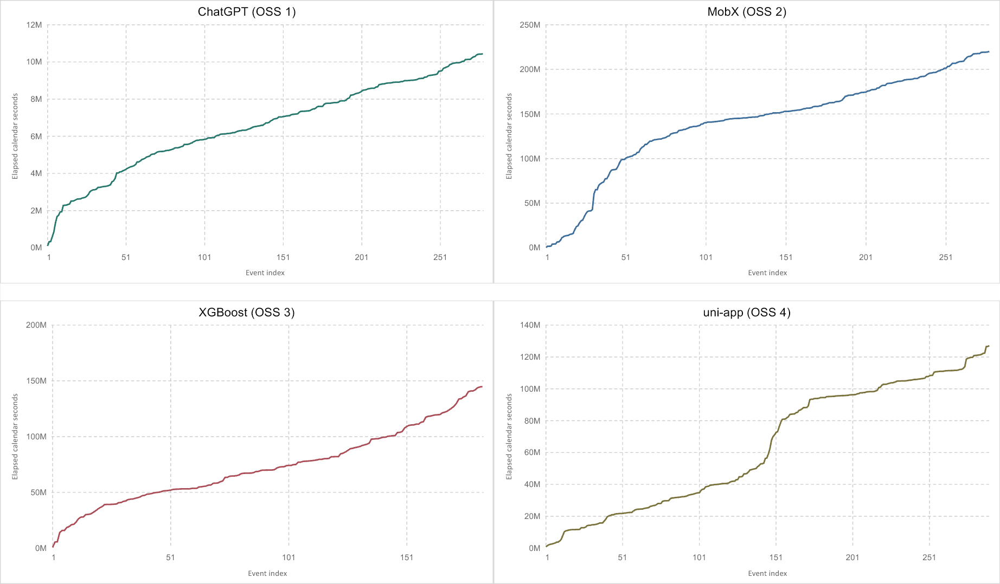

# Long-Horizon Multi-Kernel Fault-Count Prediction

Data for **Long-Horizon Software Fault-Count Prediction via Sequentially Updated Multi-Kernel Intensity Estimation**.

This release contains the four open-source datasets used in the paper, their archived issue records, and a deterministic reconstruction script. The model inputs are **individual fault-detection times in elapsed calendar seconds**, not monthly fault counts. Fault counts are the prediction target in the paper.

[Download the complete workbook](data/JSS_OSS_time_datasets_OSS1_OSS4.xlsx) | [One-column Excel inputs](data/OSS) | [Data dictionary](docs/data_dictionary.md) | [Reconstruction script](scripts/construct_oss_time_datasets.py)



## Datasets

| Paper ID | Project | Repository | Model events | Observation range (calendar seconds) | Archived records |
|---|---|---|---:|---:|---:|
| OSS 1 | ChatGPT | [lencx/ChatGPT](https://github.com/lencx/ChatGPT) | 278 | 0-10,437,067 | 279 |
| OSS 2 | MobX | [mobxjs/mobx](https://github.com/mobxjs/mobx) | 278 | 0-220,139,318 | 279 |
| OSS 3 | XGBoost | [dmlc/xgboost](https://github.com/dmlc/xgboost) | 183 | 0-144,869,150 | 184 |
| OSS 4 | uni-app | [dcloudio/uni-app](https://github.com/dcloudio/uni-app) | 290 | 0-127,116,130 | 291 |

Each `data/OSS/OSS_*.xlsx` file contains one numeric column with **no header**. The combined workbook also contains the same four arrays as sheets `OSS_1` through `OSS_4`, alongside `Dataset_Metadata`, `Raw_Issue_Records`, and `README`.

The paper's lower bound of zero is the **observation origin**, not an additional model event. The earliest issue in each archived project sheet defines that origin and is excluded from the model array. Therefore, each dataset has one more archived issue than model events. The first model times are 96,979, 323,567, 520,678, and 789,996 seconds, respectively.

## Reproduce the Time Arrays

Run from the repository root with Python 3.10 or later:

```bash
python -m pip install -r requirements.txt
python scripts/construct_oss_time_datasets.py --check-only
python -m unittest discover -s tests -v
```

To also write reconstructed, headerless CSV arrays:

```bash
python scripts/construct_oss_time_datasets.py
```

Outputs are written to `data/processed_time/`. The script rebuilds the arrays from the preserved UTC timestamp **text**, rather than relying on Excel's cached formulas. It checks every value against both the combined workbook's model sheets and the four standalone Excel inputs, and checks the paper's event counts and time limits. Any mismatch produces a nonzero exit code.

Read an Excel input directly:

```python
from openpyxl import load_workbook

workbook = load_workbook("data/OSS/OSS_1.xlsx", read_only=True, data_only=True)
times = [row[0] for row in workbook.active.iter_rows(values_only=True)]
workbook.close()
```

## Construction and Provenance

1. Retain the records in the four matched historical crawler sheets.
2. Sort each project's records by issue creation timestamp in UTC, then issue number.
3. Use the earliest timestamp as `t0`.
4. For each subsequent issue, compute `t_i = (created_at_i - t0)` in whole calendar seconds.
5. Keep the chronological event sequence. Do not aggregate by month, prepend an artificial zero, or replace elapsed times with interarrival times.

The complete workbook preserves issue numbers, titles, original labels, original UTC strings, issue URLs, source row numbers, and the time-origin records. Its metadata records the archived source workbook/sheet names and SHA-256 hashes. All 1,029 model times were checked against the historical cleaned arrays and the corresponding experiment input files.

**Interpretation and limitations.** Issue creation time is a proxy for fault detection, not CPU time, execution time, or a verified repair date. This is a historical snapshot, not a fresh GitHub extraction. Some selected records do not carry a label containing `bug`: 0 in ChatGPT, 6 in MobX, 17 in XGBoost, and 2 in uni-app, among model events. These records are preserved to reproduce the analyzed data; the release does not claim that every issue was independently confirmed to be a defect or bug fix. See the original labels and the `Has Bug Label` field before applying a different selection rule.

## Repository Layout

```text
.
|-- README.md
|-- requirements.txt
|-- data/
|   |-- JSS_OSS_time_datasets_OSS1_OSS4.xlsx
|   |-- OSS/                       # Four original one-column Excel inputs
|   `-- processed_time/            # Reconstructed arrays and summary CSV
|-- docs/
|   |-- data_dictionary.md
|   `-- figures/oss_time_sequences.png
|-- scripts/
|   `-- construct_oss_time_datasets.py
|-- tests/
|   `-- test_construct_oss_time_datasets.py
`-- .github/workflows/validate-data.yml
```

## Release Scope

This initial release covers the four OSS **time datasets** and their reconstruction checks. It does not include the four closed-source datasets or the paper's forecasting implementations. The OSS IDs here are specific to this paper and must not be substituted for the earlier IST monthly count-data IDs.
